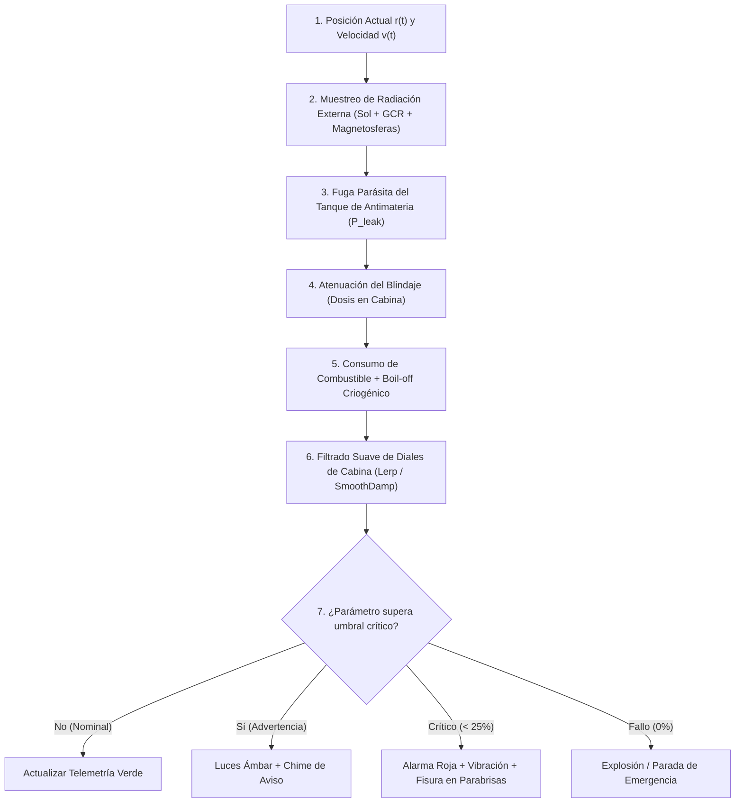

# 03. Modelo Computacional y Algoritmos de Vuelo

Este documento describe la arquitectura algorítmica y el bucle numérico de simulación paso a paso para evaluar en tiempo real la radiación ambiental, el consumo de combustible, la degradación de la nave y la actualización progresiva de los instrumentos de cabina.

---

## 1. Diagrama de Flujo del Bucle de Simulación por Frame

En cada tick de física (`FixedUpdate` o `Update` con $\Delta t$ escalado por el multiplicador de tiempo):



---

## 2. Pseudocódigo del Algoritmo de Integración

```csharp
// Algoritmo de Integración de Vuelo, Radiación y Masa
public void UpdateFlightStep(float dt)
{
    // 1. Cinemática e Interpolación de Posición
    Vector3 currentPos = Vector3.Lerp(originPos, destinationPos, flightProgress);
    double distanceTraveledKm = totalMissionDistanceKm * flightProgress;
    
    // 2. Muestreo de Radiación Ambiental Externa
    double distSunKm = Vector3.Distance(currentPos, sunPos) * KmPerUnityUnit;
    double r_AU = distSunKm / SpaceConstants.KmPerAU;
    
    // Flujo solar con ley de cuadrado inverso (1 / r^2)
    double doseRateSolar = baseSolarDoseRate_mSvPerDay / (r_AU * r_AU);
    double doseRateGCR = baseGCRDoseRate_mSvPerDay; // 1.8 mSv/día constante
    
    // Contribución de magnetosferas planetarias (ej: Júpiter o Tierra)
    double doseRatePlanetaryMag = 0.0;
    foreach (var planet in magneticPlanets)
    {
        double distKm = Vector3.Distance(currentPos, planet.pos) * KmPerUnityUnit;
        if (distKm < planet.radiationBeltRadiusKm * 3.0)
        {
            // Modelo gaussiano de campo magnético
            double deltaR = distKm - planet.radiationBeltRadiusKm;
            doseRatePlanetaryMag += planet.peakRadiation_mSvPerSec * 
                                    Math.Exp(-(deltaR * deltaR) / (2.0 * planet.sigmaKm * planet.sigmaKm));
        }
    }
    
    double totalExternalDoseRate_mSvPerSec = (doseRateSolar + doseRateGCR) / 86400.0 + doseRatePlanetaryMag;

    // 3. Fuga de Radiación Parásita por Almacenamiento de Antimateria
    double internalAntimatterLeakDoseRate = 0.0;
    if (selectedPropulsion == PropulsionMode.Antimatter && currentAntimatterFuelKg > 0)
    {
        // La potencia de fuga escala proporcionalmente a la masa almacenada
        double residualGasFactor = 1.2e-6; // mSv/s por kg almacenado
        internalAntimatterLeakDoseRate = currentAntimatterFuelKg * residualGasFactor;
    }

    // 4. Atenuación del Blindaje en Cabina (Ley de Beer-Lambert)
    double shieldAttenuationFactor = Math.Pow(0.5, currentShieldThicknessCm / selectedMaterial.HVL_cm);
    double cabinDoseRate_mSvPerSec = (totalExternalDoseRate_mSvPerSec * shieldAttenuationFactor) + 
                                     internalAntimatterLeakDoseRate;
    
    // Acumulación de Dosis
    accumulatedCabinDose_mSv += cabinDoseRate_mSvPerSec * dt * timeWarpMultiplier;

    // 5. Consumo de Combustible y Pérdida Criogénica (Boil-off)
    if (selectedPropulsion == PropulsionMode.Chemical)
    {
        double boilOffLoss = currentFuelKg * (dailyBoilOffRate / 86400.0) * dt * timeWarpMultiplier;
        double burnRate = isAccelerating ? (nominalMassFlowRateKgPerSec * dt * timeWarpMultiplier) : 0.0;
        currentFuelKg = Math.Max(0.0, currentFuelKg - (burnRate + boilOffLoss));
    }
    else if (selectedPropulsion == PropulsionMode.Antimatter)
    {
        double burnRate = isAccelerating ? (antimatterMassFlowRateKgPerSec * dt * timeWarpMultiplier) : 0.0;
        currentAntimatterFuelKg = Math.Max(0.0, currentAntimatterFuelKg - burnRate);
    }

    // 6. Integridad del Casco por Fricción con el Medio Interestelar (ISM)
    if (currentVelocityKms > 30000.0) // > 0.10c
    {
        double speedFractionC = currentVelocityKms / SpaceConstants.SpeedOfLight_kms;
        double ismErosionRatePerSec = Math.Pow(speedFractionC, 3.0) * selectedMaterial.ISMErosionFactor;
        hullIntegrityPercent = Math.Max(0.0, hullIntegrityPercent - (ismErosionRatePerSec * dt * timeWarpMultiplier));
    }

    // 7. Filtrado Suave de los Indicadores de Cabina (Evitar saltos bruscos)
    smoothedCabinDoseRate = Mathf.Lerp(smoothedCabinDoseRate, (float)cabinDoseRate_mSvPerSec * 3600f, dt * 2.5f);
    smoothedHullIntegrity = Mathf.Lerp(smoothedHullIntegrity, (float)hullIntegrityPercent, dt * 3.0f);

    // 8. Evaluación de Estados Críticos
    EvaluateVehicleStatusAlerts();
}
```

---

## 3. Dinámica de Agujas y Diales en Cabina (Respuesta Progresiva)

Para que los instrumentos no reaccionen de manera brusca o artificial:
* Se implementa un **filtro pasa-bajos de primer orden (suavizado exponencial `Lerp`)** con constante de tiempo $\tau \approx 0.4\text{ s}$.
* Los diales de aguja del acelerómetro y manómetros de presión presentan una **pequeña inercia mecánica**:
  $$\frac{d^2 \theta}{dt^2} + 2\zeta \omega_n \frac{d\theta}{dt} + \omega_n^2 \theta = \omega_n^2 \theta_{\text{objetivo}}$$
* Si la nave ingresa a una región de alta radiación (ej. cruce de cinturones magnéticos), el medidor no se clava en el fondo al instante, sino que el piloto observa **cómo la aguja escala progresivamente hacia la zona de advertencia**, otorgando tiempo para virar o desplegar blindaje secundario.

---

## 4. Condiciones de Fallo y Disparo de Eventos Visuales

| Condición Límite | Umbral Numérico | Respuesta Inmersiva en la Cabina |
| :--- | :--- | :--- |
| **Dosis Crítica Tripulación** | $> 1.0\text{ Sv} \ (1.000\text{ mSv})$ | Zumbido de audio tipo contador Geiger acelerado. Notificación en pantalla: *"ALERTA MÉDICA: Dosis de radiación acumulada supera 1 Sv"*. |
| **Pérdida de Blindaje ISM** | Integridad $< 20\%$ | **Aparecen texturas de fisuras de impacto en el cristal del parabrisas**. Sonido de micro-impactos continuos de partículas. |
| **Déficit de Combustible** | Combustible $= 0\text{ kg}$ antes del 90% | Apagado de los motores. La telemetría marca: *"Reserva agotada. Trayectoria hiperbólica no capturada (Nave a la deriva)"*. |
| **Destrucción Catastrófica** | Integridad $= 0\%$ | Fogonazo blanco en pantalla completa, sacudida violenta de cámara y transición a pantalla de misión abortada con análisis de causa física. |

